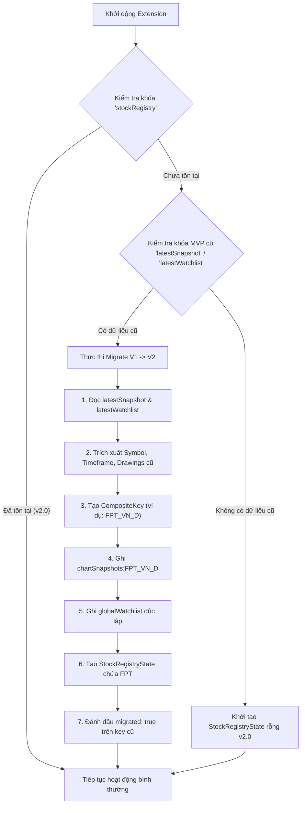

# MÔ HÌNH DỮ LIỆU ĐA MÃ CỔ PHIẾU (MULTI-STOCK DATA MODEL)

**Dự án:** Stock Chart Extractor – Multi-Stock Management Architecture  
**Tài liệu:** Đặc tả mô hình dữ liệu TypeScript, lược đồ kiểm thực Zod, phân vùng lưu trữ Chrome Storage và chiến lược Migration  
**Phiên bản:** 2.0  
**Ngày khởi tạo:** 17/11/2026  
**Trạng thái kiểm duyệt:** DATA SPECIFICATION (Ready for Review)

---

## 1. NGUYÊN TẮC THIẾT KẾ MÔ HÌNH DỮ LIỆU

Hệ thống dữ liệu của Stock Chart Extractor 2.0 được xây dựng dựa trên 3 nguyên tắc phân rã bắt buộc:

1. **Phân vùng độc lập theo Ngữ cảnh Biểu đồ (Per-Stock Context Isolation):**
   - Các đối tượng vẽ (Drawings) và chỉ báo kỹ thuật (Indicators) gắn liền với một biểu đồ cụ thể, được định danh bằng bộ ba `symbol + exchange + timeframe`.
   - Dữ liệu biểu đồ của mã `FPT` khung `15m` tuyệt đối không bị trộn lẫn hoặc ghi đè sang mã `VIC` khung `1D`.
2. **Tách biệt Dữ liệu Người dùng Toàn cục (Global User Data Decoupling):**
   - Watchlist (Danh sách theo dõi) là tài sản toàn cục của người dùng trên FireAnt.
   - Watchlist được lưu trữ độc lập ở khóa toàn cục; **tuyệt đối không nhân bản hoặc sao chép Watchlist vào từng bản ghi Chart Snapshot**.
3. **Trung tâm quản lý mã duy nhất (Unified Registry Single-Source-of-Truth):**
   - Mọi mã cổ phiếu (phát hiện từ FireAnt hay người dùng thêm thủ công) được định tuyến và quản lý tập trung thông qua `StockRegistry`.

---

## 2. HỆ THỐNG KIỂU DỮ LIỆU TYPESCRIPT (TYPESCRIPT INTERFACES)

### 2.1. Định danh Ngữ cảnh Biểu đồ (Chart Context Identity)

```typescript
export interface ChartContextId {
  /** Mã cổ phiếu đã chuẩn hóa (ví dụ: 'FPT', 'VCB') */
  symbol: string;

  /** Sàn giao dịch nếu có (ví dụ: 'HOSE', 'HNX', 'UPCOM') */
  exchange?: string;

  /** Khung thời gian biểu đồ (ví dụ: '1', '5', '15', '60', 'D', 'W') */
  timeframe: string;

  /** Định danh biểu đồ trong multi-layout (ví dụ: 'chart-0', 'chart-1') */
  chartId: string;

  /** Khóa phức hợp duy nhất: symbol_exchange_timeframe */
  compositeKey: string;
}

/** Hàm tiện ích tạo Composite Key chuẩn hóa */
export function buildChartCompositeKey(symbol: string, timeframe: string, exchange?: string): string {
  const cleanSymbol = symbol.trim().toUpperCase();
  const cleanTimeframe = timeframe.trim();
  const cleanExchange = exchange ? exchange.trim().toUpperCase() : 'VN';
  return `${cleanSymbol}_${cleanExchange}_${cleanTimeframe}`;
}
```

### 2.2. Mô hình Đối tượng Vẽ (Drawing Entities)

```typescript
export type DrawingType = 
  | 'horizontal_line' 
  | 'trend_line' 
  | 'rectangle' 
  | 'ray' 
  | 'extended_line' 
  | 'pitchfork' 
  | 'fib_retracement' 
  | 'text' 
  | 'unknown';

export interface DrawingPoint {
  /** Thời gian của điểm (Unix timestamp ms) */
  time: number;
  /** Mức giá tại điểm */
  price: number;
}

export interface DrawingStyle {
  color?: string;
  lineWidth?: number;
  lineStyle?: number; // 0: solid, 1: dotted, 2: dashed
  fillColor?: string;
  transparency?: number;
}

export interface DrawingItem {
  id: string;
  type: DrawingType;
  title: string;
  points: DrawingPoint[];
  properties: Record<string, unknown>;
  style: DrawingStyle;
  extractedAt: number;
}
```

### 2.3. Mô hình Chỉ báo Kỹ thuật (Technical Indicator Entities)

```typescript
export interface IndicatorPlot {
  id: string;
  title: string;
  type: string; // 'line', 'histogram', 'arrows'
  color?: string;
}

export interface IndicatorItem {
  id: string;
  name: string;
  shortName: string;
  description: string;
  inputs: Record<string, unknown>;
  plots: IndicatorPlot[];
  styles: Record<string, unknown>;
  isVisible: boolean;
  extractedAt: number;
}
```

### 2.4. Bản Snapshot Biểu đồ Cô lập (Isolated Chart Snapshot)

```typescript
export interface IsolatedChartSnapshot {
  /** Phiên bản schema snapshot */
  version: '2.0';

  /** Thông tin định danh ngữ cảnh của snapshot */
  context: ChartContextId;

  /** Khóa phức hợp (trùng với context.compositeKey để tra cứu nhanh) */
  compositeKey: string;

  /** Mã thế hệ (Generation ID) ngăn ngừa race condition ghi đè dữ liệu cũ */
  generationId: number;

  /** Danh sách các đối tượng vẽ trích xuất được */
  drawings: DrawingItem[];

  /** Danh sách các chỉ báo kỹ thuật trích xuất được */
  indicators: IndicatorItem[];

  /** Tổng số đối tượng vẽ */
  drawingsCount: number;

  /** Tổng số chỉ báo */
  indicatorsCount: number;

  /** Thời điểm trích xuất hoàn tất (Unix timestamp ms) */
  extractedAt: number;
}
```

### 2.5. Mô hình Dữ liệu Danh mục Theo dõi Toàn cục (Global Watchlist Snapshot)

```typescript
export interface WatchlistStockItem {
  symbol: string;
  exchange?: string;
  companyName?: string;
  note?: string;
}

export interface WatchlistCategory {
  id: string;
  name: string;
  order: number;
  symbols: string[];
}

export interface GlobalWatchlistSnapshot {
  version: '2.0';
  activeCategoryId: string | null;
  categories: WatchlistCategory[];
  stocks: Record<string, WatchlistStockItem>;
  totalStocksCount: number;
  lastSyncedAt: number;
}
```

### 2.6. Mô hình Quản lý Danh bạ Mã (Stock Registry Schema)

```typescript
export type StockSource = 'FIREANT' | 'EXTENSION';

export interface ChartContextSummary {
  chartId: string;
  timeframe: string;
  compositeKey: string;
  lastSyncAt: number;
  drawingsCount: number;
  indicatorsCount: number;
}

export interface StockRegistryItem {
  symbol: string;
  exchange?: string;
  sources: StockSource[];
  isOpened: boolean;
  isActive: boolean;
  chartContexts: ChartContextSummary[];
  lastDetectedAt: number;
  createdAt: number;
}

export interface StockRegistryState {
  version: '2.0';
  activeSymbol: string | null;
  activeCompositeKey: string | null;
  items: Record<string, StockRegistryItem>;
  updatedAt: number;
}
```

---

## 3. LƯỢC ĐỒ KIỂM THỰC RUNTIME (ZOD SCHEMAS)

Để đảm bảo tính an toàn kiểu (Type-Safety) tuyệt đối khi truyền dữ liệu qua `window.postMessage` và `chrome.runtime.sendMessage`, tất cả gói tin được kiểm chứng qua Zod:

```typescript
import { z } from 'zod';

export const ChartContextIdSchema = z.object({
  symbol: z.string().min(1),
  exchange: z.string().optional(),
  timeframe: z.string().min(1),
  chartId: z.string(),
  compositeKey: z.string(),
});

export const DrawingPointSchema = z.object({
  time: z.number(),
  price: z.number(),
});

export const DrawingItemSchema = z.object({
  id: z.string(),
  type: z.string(),
  title: z.string(),
  points: z.array(DrawingPointSchema),
  properties: z.record(z.unknown()),
  style: z.record(z.unknown()),
  extractedAt: z.number(),
});

export const IndicatorItemSchema = z.object({
  id: z.string(),
  name: z.string(),
  shortName: z.string(),
  description: z.string().default(''),
  inputs: z.record(z.unknown()),
  plots: z.array(z.any()),
  styles: z.record(z.unknown()),
  isVisible: z.boolean().default(true),
  extractedAt: z.number(),
});

export const IsolatedChartSnapshotSchema = z.object({
  version: z.literal('2.0'),
  context: ChartContextIdSchema,
  compositeKey: z.string(),
  generationId: z.number(),
  drawings: z.array(DrawingItemSchema),
  indicators: z.array(IndicatorItemSchema),
  drawingsCount: z.number().int().nonnegative(),
  indicatorsCount: z.number().int().nonnegative(),
  extractedAt: z.number(),
});

export const GlobalWatchlistSnapshotSchema = z.object({
  version: z.literal('2.0'),
  activeCategoryId: z.string().nullable(),
  categories: z.array(z.object({
    id: z.string(),
    name: z.string(),
    order: z.number(),
    symbols: z.array(z.string()),
  })),
  stocks: z.record(z.any()),
  totalStocksCount: z.number().int().nonnegative(),
  lastSyncedAt: z.number(),
});

export const StockRegistryItemSchema = z.object({
  symbol: z.string().min(1),
  exchange: z.string().optional(),
  sources: z.array(z.enum(['FIREANT', 'EXTENSION'])),
  isOpened: z.boolean(),
  isActive: z.boolean(),
  chartContexts: z.array(z.any()),
  lastDetectedAt: z.number(),
  createdAt: z.number(),
});

export const StockRegistryStateSchema = z.object({
  version: z.literal('2.0'),
  activeSymbol: z.string().nullable(),
  activeCompositeKey: z.string().nullable(),
  items: z.record(StockRegistryItemSchema),
  updatedAt: z.number(),
});
```

---

## 4. PHÂN VÙNG LƯU TRỮ TRONG CHROME LOCAL STORAGE

Bộ nhớ `chrome.storage.local` được phân vùng bằng các tiền tố rõ ràng (Partitioned Keys):

```
+-------------------------------------------------------------------------+
| chrome.storage.local                                                    |
+-------------------------------------------------------------------------+
| [Khóa] "stockRegistry"                                                  |
| -> Giá trị: StockRegistryState                                          |
| (Chứa toàn bộ danh bạ mã, trạng thái isOpened/isActive, summary counts)  |
+-------------------------------------------------------------------------+
| [Khóa] "chartSnapshots:FPT_HOSE_15"                                     |
| -> Giá trị: IsolatedChartSnapshot (Drawings + Indicators của FPT 15m)    |
+-------------------------------------------------------------------------+
| [Khóa] "chartSnapshots:VIC_HOSE_D"                                      |
| -> Giá trị: IsolatedChartSnapshot (Drawings + Indicators của VIC 1D)     |
+-------------------------------------------------------------------------+
| [Khóa] "chartSnapshots:<compositeKey>"                                  |
| -> Mỗi biểu đồ cô lập chiếm 1 key riêng biệt                             |
+-------------------------------------------------------------------------+
| [Khóa] "globalWatchlist"                                                |
| -> Giá trị: GlobalWatchlistSnapshot                                     |
| (Danh sách theo dõi toàn cục độc lập)                                   |
+-------------------------------------------------------------------------+
| [Khóa] "appSettings"                                                    |
| -> Giá trị: { autoSync: boolean, syncIntervalMs: number, theme: string } |
+-------------------------------------------------------------------------+
```

### Lợi ích của kiến trúc phân vùng này:
1. **Tránh nghẽn IO:** Khi cập nhật dữ liệu của mã `FPT`, Side Panel chỉ đọc/ghi key `"chartSnapshots:FPT_HOSE_15"`, không cần serialize lại toàn bộ database.
2. **Lắng nghe sự kiện chi tiết:** `chrome.storage.onChanged` chỉ kích hoạt cho đúng khóa bị thay đổi, giúp UI cập nhật tức thì với hiệu năng tối ưu.
3. **Dễ dàng giải phóng bộ nhớ (Quota Management):** Khi người dùng xóa mã hoặc vượt giới hạn dung lượng, chỉ cần xóa bỏ chính xác key snapshot tương ứng.

---

## 5. QUY TẮC CHUẨN HÓA DỮ LIỆU (DATA NORMALIZATION RULES)

Module `DataNormalizer` thi hành các quy chuẩn bắt buộc:

1. **Chuẩn hóa Mã cổ phiếu (`Symbol`):**
   - Loại bỏ khoảng trắng đầu/cuối.
   - Chuyển thành chữ in hoa toàn bộ.
   - Loại bỏ ký tự đặc biệt không hợp lệ.
   - Ví dụ: `" fpt "` $\rightarrow$ `"FPT"`, `"vic/vn"` $\rightarrow$ `"VIC"`.
2. **Chuẩn hóa Khung thời gian (`Timeframe`):**
   - Giữ nguyên các định danh chuẩn TradingView:
     - Khung phút: `'1'`, `'5'`, `'15'`, `'30'`, `'60'`, `'120'`, `'240'`.
     - Khung ngày/tuần/tháng: `'D'`, `'W'`, `'M'`.
   - Nếu timeframe rỗng hoặc không xác định: mặc định gán `'D'`.
3. **Chuẩn hóa Thời gian (`Timestamp`):**
   - Tất cả thời gian phải là số nguyên Unix timestamp tính bằng mili-giây (`ms`).
   - Nếu dữ liệu nguồn trả về giây (`s`), bắt buộc nhân $1000$.
4. **Chuẩn hóa Giá trị Số (`Price` & `Coordinates`):**
   - Loại bỏ `NaN`, `Infinity`.
   - Làm tròn tối đa 4 chữ số thập phân đối với giá cổ phiếu Việt Nam (bước giá tối thiểu $0.01$ - $0.05$).
5. **Chuẩn hóa Mã màu (`Colors`):**
   - Chuẩn hóa về chuỗi HEX (`#RRGGBB` hoặc `#RRGGBBAA`) hoặc `rgba(...)`.

---

## 6. CHIẾN LƯỢC CHUYỂN ĐỔI DỮ LIỆU TỪ MVP 1.0 (MIGRATION STRATEGY)

Để đảm bảo người dùng đang chạy phiên bản cũ nâng cấp lên bản 2.0 mà không bị mất dữ liệu đã trích xuất, `StorageRepository` cung cấp hàm tự động migrate khi khởi động:



### Thuật toán thực thi di chuyển dữ liệu:
```typescript
export async function migrateStorageV1toV2(): Promise<void> {
  const legacyData = await chrome.storage.local.get([
    'stockRegistry',
    'latestSnapshot',
    'latestIndicators',
    'latestWatchlist',
  ]);

  if (legacyData.stockRegistry) {
    // Đã ở v2.0, không cần migration
    return;
  }

  console.log('[Storage Migration] Detected legacy MVP 1.0 data. Starting migration to Multi-Stock 2.0...');

  const now = Date.now();
  const registryItems: Record<string, StockRegistryItem> = {};
  let activeSymbol: string | null = null;
  let activeCompositeKey: string | null = null;

  // 1. Chuyển đổi Snapshot & Indicators
  if (legacyData.latestSnapshot) {
    const rawSnap = legacyData.latestSnapshot;
    const symbol = (rawSnap.symbol || 'UNKNOWN').trim().toUpperCase();
    const timeframe = rawSnap.timeframe || 'D';
    const exchange = rawSnap.exchange || 'VN';
    const compositeKey = buildChartCompositeKey(symbol, timeframe, exchange);

    const migratedSnapshot: IsolatedChartSnapshot = {
      version: '2.0',
      context: {
        symbol,
        exchange,
        timeframe,
        chartId: 'chart-main-0',
        compositeKey,
      },
      compositeKey,
      generationId: 1,
      drawings: rawSnap.drawings || [],
      indicators: legacyData.latestIndicators?.items || [],
      drawingsCount: rawSnap.drawings?.length || 0,
      indicatorsCount: legacyData.latestIndicators?.items?.length || 0,
      extractedAt: rawSnap.extractedAt || now,
    };

    // Ghi snapshot mới theo composite key
    await chrome.storage.local.set({
      [`chartSnapshots:${compositeKey}`]: migratedSnapshot,
    });

    registryItems[symbol] = {
      symbol,
      exchange,
      sources: ['FIREANT'],
      isOpened: true,
      isActive: true,
      chartContexts: [{
        chartId: 'chart-main-0',
        timeframe,
        compositeKey,
        lastSyncAt: migratedSnapshot.extractedAt,
        drawingsCount: migratedSnapshot.drawingsCount,
        indicatorsCount: migratedSnapshot.indicatorsCount,
      }],
      lastDetectedAt: now,
      createdAt: now,
    };

    activeSymbol = symbol;
    activeCompositeKey = compositeKey;
  }

  // 2. Chuyển đổi Watchlist sang khóa toàn cục độc lập
  if (legacyData.latestWatchlist) {
    const rawWatchlist = legacyData.latestWatchlist;
    const globalWatchlist: GlobalWatchlistSnapshot = {
      version: '2.0',
      activeCategoryId: rawWatchlist.activeCategoryId || null,
      categories: rawWatchlist.categories || [],
      stocks: rawWatchlist.stocks || {},
      totalStocksCount: rawWatchlist.activeItems?.length || 0,
      lastSyncedAt: rawWatchlist.extractedAt || now,
    };

    await chrome.storage.local.set({ globalWatchlist });
  }

  // 3. Ghi khởi tạo StockRegistryState
  const initialRegistry: StockRegistryState = {
    version: '2.0',
    activeSymbol,
    activeCompositeKey,
    items: registryItems,
    updatedAt: now,
  };

  await chrome.storage.local.set({ stockRegistry: initialRegistry });
  console.log('[Storage Migration] Migration to Multi-Stock 2.0 completed successfully.');
}
```
