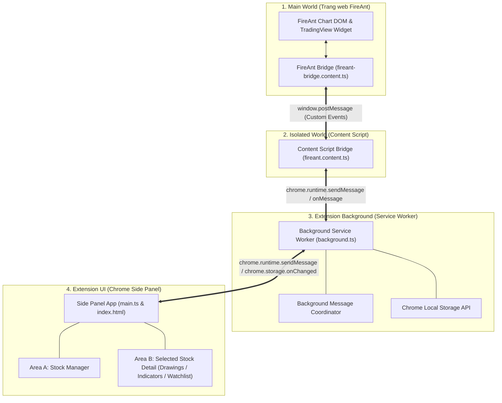
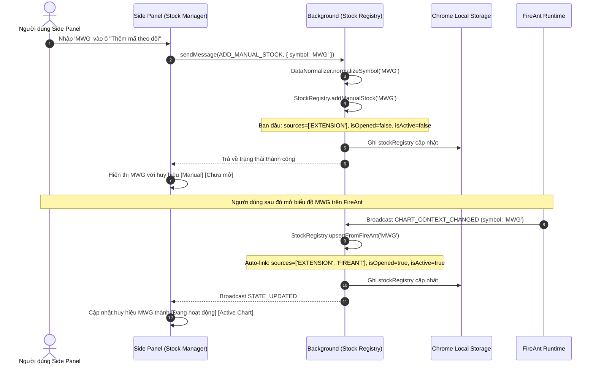
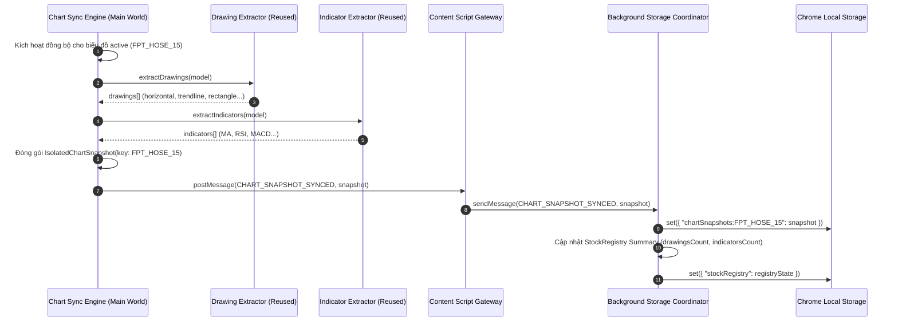
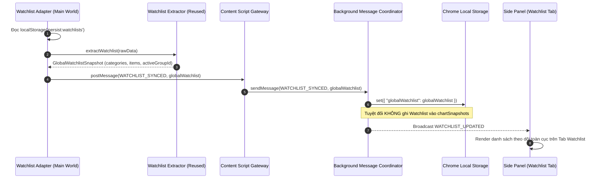

# KIẾN TRÚC HỆ THỐNG QUẢN LÝ ĐA MÃ CỔ PHIẾU (MULTI-STOCK MANAGEMENT ARCHITECTURE)

**Dự án:** Stock Chart Extractor – Multi-Stock Management Architecture  
**Tài liệu:** Thiết kế kiến trúc tổng thể hệ thống, phân rã module, ranh giới xử lý và luồng dữ liệu  
**Phiên bản:** 2.0  
**Ngày khởi tạo:** 17/11/2026  
**Trạng thái kiểm duyệt:** ARCHITECTURE SPECIFICATION (Ready for Review)

---

## 1. TỔNG QUAN HỆ THỐNG VÀ ĐỊNH HƯỚNG SẢN PHẨM

Hệ thống **Stock Chart Extractor 2.0** được thiết kế lại nhằm giải quyết bài toán cốt lõi: **chuyển đổi từ mô hình trích xuất đơn mã (Single-Stock MVP) sang hệ thống quản lý danh mục đa mã cổ phiếu (Multi-Stock Management)** trên nền tảng web FireAnt (`https://fireant.vn/b/charts`).

### 1.1. Mục tiêu cốt lõi:
1. **Hợp nhất hai nguồn quản lý mã:**
   - **Nguồn tự động (FIREANT):** Tự động phát hiện các biểu đồ, tab và bố cục đang được mở trên FireAnt, tự động phát hiện biểu đồ đang chọn (Active Chart), mã cổ phiếu (`symbol`), sàn giao dịch (`exchange`) và khung thời gian (`timeframe`).
   - **Nguồn thủ công (EXTENSION):** Cho phép người dùng chủ động thêm mã cần theo dõi hoặc xóa mã khỏi danh sách quản lý của Extension. Tự động liên kết (Auto-linking) mã thủ công khi biểu đồ tương ứng được mở trên FireAnt.
2. **Cô lập và phân vùng dữ liệu nghiêm ngặt:**
   - **Dữ liệu theo biểu đồ (Per-stock, per-timeframe data):** Bao gồm Drawings (đối tượng vẽ) và Indicators (chỉ báo kỹ thuật). Được lập chỉ mục theo khóa phức hợp `symbol + exchange + timeframe + chartId`.
   - **Dữ liệu người dùng toàn cục (Global user data):** Watchlist (danh sách theo dõi cá nhân). Độc lập hoàn toàn với biểu đồ đang chọn; tuyệt đối **không** sao chép Watchlist vào từng Chart Snapshot.
3. **Bảo toàn và kế thừa mã nguồn MVP:**
   - Bảo toàn 100% các module trích xuất đối tượng vẽ (`Drawing Extractor`, `base.extractor.ts`, các extractor hình học: horizontal line, trendline, rectangle) và các module trích xuất chỉ báo/danh mục đã được nghiệm thu trong MVP và Phase 3.

---

## 2. RANH GIỚI VÀ TIẾN TRÌNH THỰC THI (PROCESS BOUNDARIES)

Hệ thống Chrome Extension Manifest V3 hoạt động trên 4 môi trường ngữ cảnh cô lập (Execution Contexts):



1. **Main World (`fireant-bridge.content.ts`):** Chạy trực tiếp trong ngữ cảnh JavaScript của trang web FireAnt. Có quyền truy cập bộ nhớ RAM của `window.chartWidget`, `chartWidget.model().m_model`, và `localStorage` của FireAnt.
2. **Isolated World (`fireant.content.ts`):** Chạy trong môi trường cô lập của Content Script. Đóng vai trò cầu nối bảo mật (Secure Gateway) chuyển tiếp message giữa Main World và Background Service Worker.
3. **Background Service Worker (`background.ts`):** Điều phối thông điệp (Background Message Coordinator), quản lý lưu trữ bất đồng bộ (`Storage Repository`), đồng bộ trạng thái giữa các tab và Side Panel.
4. **Side Panel (`entrypoints/sidepanel/`):** Giao diện đồ họa người dùng hiển thị trực quan thông tin quản lý mã và dữ liệu biểu đồ được trích xuất.

---

## 3. PHÂN RÃ VÀ TRÁCH NHIỆM 14 MODULE KIẾN TRÚC

Hệ thống được tổ chức theo nguyên tắc Single Responsibility Principle (SRP) thành 14 module chức năng:

| STT | Tên Module | Vị trí ngữ cảnh | Trách nhiệm chính (Single Responsibility) | Trạng thái mã nguồn |
|:---:|---|---|---|:---:|
| 1 | **Chart Tab Detector** | Main World | Phát hiện sự hiện diện của biểu đồ, số lượng biểu đồ trong layout (`chartsCount()`), và các tab làm việc của FireAnt. | Module mới |
| 2 | **Active Chart Tracker** | Main World | Theo dõi biểu đồ đang có tiêu điểm (Active Chart), lắng nghe sự kiện đổi mã (`onSymbolChange`) và đổi khung thời gian (`onIntervalChange`). | Module mới |
| 3 | **FireAnt Chart Adapter** | Main World | Giao tiếp bậc thấp với TradingView Widget của FireAnt; bọc an toàn các lệnh gọi method private để tránh crash khi FireAnt thay đổi API nội bộ. | Module mới |
| 4 | **Drawing Extractor** | Main World / Lib | Duyệt danh sách `allLineTools()` trên model của biểu đồ active, bóc tách tọa độ, giá, thời gian và thuộc tính hiển thị. | **Tái sử dụng 100%** |
| 5 | **Indicator Extractor** | Main World / Lib | Duyệt danh sách `allStudies()` trên model của biểu đồ active, bóc tách tên chỉ báo, tham số input, kiểu đồ thị và màu sắc. | **Tái sử dụng 100%** |
| 6 | **Watchlist Adapter** | Main World | Đọc an toàn dữ liệu danh sách theo dõi của người dùng từ Redux Persist lưu trong `localStorage.getItem('persist:watchlists')`. | Tái sử dụng |
| 7 | **Watchlist Extractor** | Main World / Lib | Giải mã và chuẩn hóa cấu trúc JSON Watchlist thành danh sách nhóm và các mã chứng khoán theo chuẩn hệ thống. | **Tái sử dụng 100%** |
| 8 | **Stock Registry** | Shared / Background | Quản lý danh bạ mã cổ phiếu thống nhất; thực thi quy tắc bảo toàn nguồn sở hữu (FIREANT vs EXTENSION), loại bỏ trùng lặp và kích hoạt auto-linking. | Module mới |
| 9 | **Data Normalizer** | Shared Lib | Chuẩn hóa mã cổ phiếu (uppercase, trim), định dạng thời gian (Unix timestamp ms), làm sạch giá trị số và ánh xạ kiểu đối tượng vẽ/chỉ báo. | Mở rộng |
| 10 | **Chart Sync Engine** | Main World / Background | Điều phối việc trích xuất đồng thời hoặc theo chu kỳ của Drawings và Indicators theo từng ngữ cảnh biểu đồ cô lập. | Module mới |
| 11 | **Watchlist Sync Engine** | Main World / Background | Điều phối việc trích xuất và đồng bộ dữ liệu Watchlist độc lập, ghi vào vùng lưu trữ toàn cục. | Module mới |
| 12 | **Storage Repository** | Background / Side Panel | Đóng gói các thao tác đọc/ghi vào `chrome.storage.local`; phân vùng theo khóa chuyên biệt; xử lý migrate schema. | Module mới |
| 13 | **Background Message Coordinator** | Background | Nhận diện, kiểm thực (Zod validation) và định tuyến các gói tin giữa Content Script và Side Panel; quản lý trạng thái kết nối. | Tái cấu trúc |
| 14 | **Side Panel UI** | Side Panel | Render giao diện hai vùng (Stock Manager & Selected Stock Detail); quản lý tương tác người dùng, chuyển tab và xuất dữ liệu JSON. | Tái cấu trúc |

---

## 4. CHI TIẾT CÁC LUỒNG DỮ LIỆU ĐIỂN HÌNH (END-TO-END FLOWS)

### 4.1. Luồng Tự động phát hiện và Chuyển đổi Biểu đồ (Automatic Chart Discovery & Active Switch)

```mermaid
sequenceDiagram
    autonumber
    actor User as Người dùng FireAnt
    participant FA as FireAnt Chart Runtime
    participant MWB as Chart Tab Detector / Active Chart Tracker
    participant ICS as Isolated Content Script
    participant BG as Background Message Coordinator & Stock Registry
    participant SP as Side Panel UI

    User->>FA: Mở hoặc đổi biểu đồ sang FPT (Khung 15m)
    FA->>FA: widget.setSymbol('FPT', '15')
    MWB->>FA: Lắng nghe onSymbolChange hoặc Polling Observer
    FA-->>MWB: Model cập nhật: symbol='FPT', timeframe='15'
    MWB->>MWB: Đóng gói ChartContextId (FPT_HOSE_15)
    MWB->>ICS: window.postMessage(CHART_CONTEXT_CHANGED, payload)
    ICS->>BG: chrome.runtime.sendMessage(CHART_CONTEXT_CHANGED)
    BG->>BG: StockRegistry.upsertFromFireAnt(FPT, HOSE, 15)
    BG->>BG: Cập nhật Storage (stockRegistry, activeContext)
    BG->>SP: Broadcast STATE_UPDATED
    SP->>SP: Highlight mã FPT trong Stock Manager; cập nhật Header Detail
```

### 4.2. Luồng Quản lý Mã Thủ công và Tự động Liên kết (Manual Stock Management & Auto-Linking)



### 4.3. Luồng Đồng bộ Dữ liệu Vẽ và Chỉ báo Cô lập (Per-Stock Drawing & Indicator Sync)



### 4.4. Luồng Đồng bộ Danh mục Toàn cục Độc lập (Global Watchlist Sync)



---

## 5. THIẾT KẾ KIẾN TRÚC GIAO DIỆN SIDE PANEL (TARGET SIDE PANEL ARCHITECTURE)

Giao diện Chrome Side Panel (`entrypoints/sidepanel/`) được tái cấu trúc thành 2 vùng làm việc độc lập và rõ ràng:

```
+-------------------------------------------------------------+
| Stock Chart Extractor 2.0                    [STATUS: READY] |
| Platform: FireAnt • Multi-Stock Management                   |
+-------------------------------------------------------------+
| [ KHU VỰC A: STOCK MANAGER (QUẢN LÝ MÃ CỔ PHIẾU) ]           |
|                                                             |
| [+ Thêm mã cổ phiếu: [ VCB       ] [ + Thêm ] ]             |
|                                                             |
| Danh sách mã đang quản lý:                                  |
| • [FPT]   [HOSE • 15m]  ● Active Chart     (5 drawings) [X] |
| • [VIC]   [HOSE • 1D]   ○ Mở trên FireAnt  (2 drawings) [X] |
| • [MWG]   [-]           ○ Thủ công (chưa mở)             [X] |
+-------------------------------------------------------------+
| [ KHU VỰC B: SELECTED STOCK DETAIL (CHI TIẾT MÃ ĐANG CHỌN) ]|
|                                                             |
| Đang chọn: FPT • HOSE • Khung: 15m                          |
| [ Tab 1: Drawings (5) ] [ Tab 2: Indicators (3) ] [ Tab 3: Watchlist (18) ] |
|-------------------------------------------------------------|
| (Nội dung Tab được chọn hiển thị tại đây)                    |
| - Nếu Tab Drawings: Hiển thị các hình vẽ của FPT_HOSE_15    |
| - Nếu Tab Indicators: Hiển thị các chỉ báo của FPT_HOSE_15  |
| - Nếu Tab Watchlist: Hiển thị danh sách theo dõi toàn cục   |
|                                                             |
| [ Copy Tab JSON ] [ Export All JSON ] [ Yêu cầu đồng bộ ]   |
+-------------------------------------------------------------+
```

### 5.1. Quy tắc hành vi giao diện:
1. **Khu vực A (Stock Manager):**
   - Luôn hiển thị danh sách tất cả mã cổ phiếu trong `StockRegistry`.
   - Hiển thị rõ nhãn nguồn gốc: Tự động phát hiện từ FireAnt hay Thêm thủ công.
   - Nút xóa `[X]` cho từng mã: Tuân thủ quy tắc bảo toàn nguồn sở hữu (chỉ xóa hẳn nếu mã không còn mở trên FireAnt).
   - Click vào bất kỳ mã nào trong danh sách: Chuyển tiêu điểm hiển thị tại Khu vực B (Active Stock Context).
2. **Khu vực B (Selected Stock Detail):**
   - Tab 1 (Drawings): Đọc và hiển thị dữ liệu từ snapshot `chartSnapshots:<compositeKey>`.
   - Tab 2 (Indicators): Đọc và hiển thị dữ liệu chỉ báo của biểu đồ đang chọn.
   - Tab 3 (Watchlist): Đọc và hiển thị danh sách toàn cục từ `globalWatchlist`. Độc lập hoàn toàn với việc người dùng đang chọn mã nào ở Khu vực A.

---

## 6. MA TRẬN BẢO TOÀN VÀ TÁI SỬ DỤNG MÃ NGUỒN (REUSABILITY AUDIT)

Hệ thống tuân thủ nghiêm ngặt nguyên tắc **không viết lại các module trích xuất đã hoạt động ổn định**:

| Tên Module / File | Trạng thái hiện tại | Quyết định kỹ thuật | Lý do & Biện pháp bảo toàn |
|---|---|---|---|
| `src/extractors/base.extractor.ts` | Hoạt động tốt | **Tái sử dụng 100%** | Giữ nguyên interface trích xuất chung của BaseDrawingExtractor. |
| `src/extractors/horizontal-line.extractor.ts` | Hoạt động tốt | **Tái sử dụng 100%** | Giữ nguyên logic trích xuất giá ngang. |
| `src/extractors/trend-line.extractor.ts` | Hoạt động tốt | **Tái sử dụng 100%** | Giữ nguyên logic trích xuất đường xu hướng 2 điểm. |
| `src/extractors/rectangle.extractor.ts` | Hoạt động tốt | **Tái sử dụng 100%** | Giữ nguyên logic trích xuất hình chữ nhật / vùng giá. |
| `src/extractors/fallback.extractor.ts` | Hoạt động tốt | **Tái sử dụng 100%** | Giữ nguyên fallback an toàn cho các line tool chưa hỗ trợ chuyên biệt. |
| `src/extractors/indicators/indicator.extractor.ts` | Hoạt động tốt | **Tái sử dụng 100%** | Giữ nguyên logic bóc tách `allStudies()`. Chỉ mở rộng gắn thêm context key. |
| `src/extractors/watchlist/watchlist.extractor.ts` | Hoạt động tốt | **Tái sử dụng 100%** | Giữ nguyên logic decode `localStorage.persist:watchlists`. |
| `entrypoints/fireant-bridge.content.ts` | Chế độ đơn mã | **Mở rộng** | Bổ sung module Tab Detector & Active Chart Tracker; gọi lại toàn bộ extractor cũ. |
| `entrypoints/sidepanel/` | Giao diện đơn mã | **Tái cấu trúc** | Tái cấu trúc thành 2 vùng (A: Stock Manager, B: Detail Tabs). |
