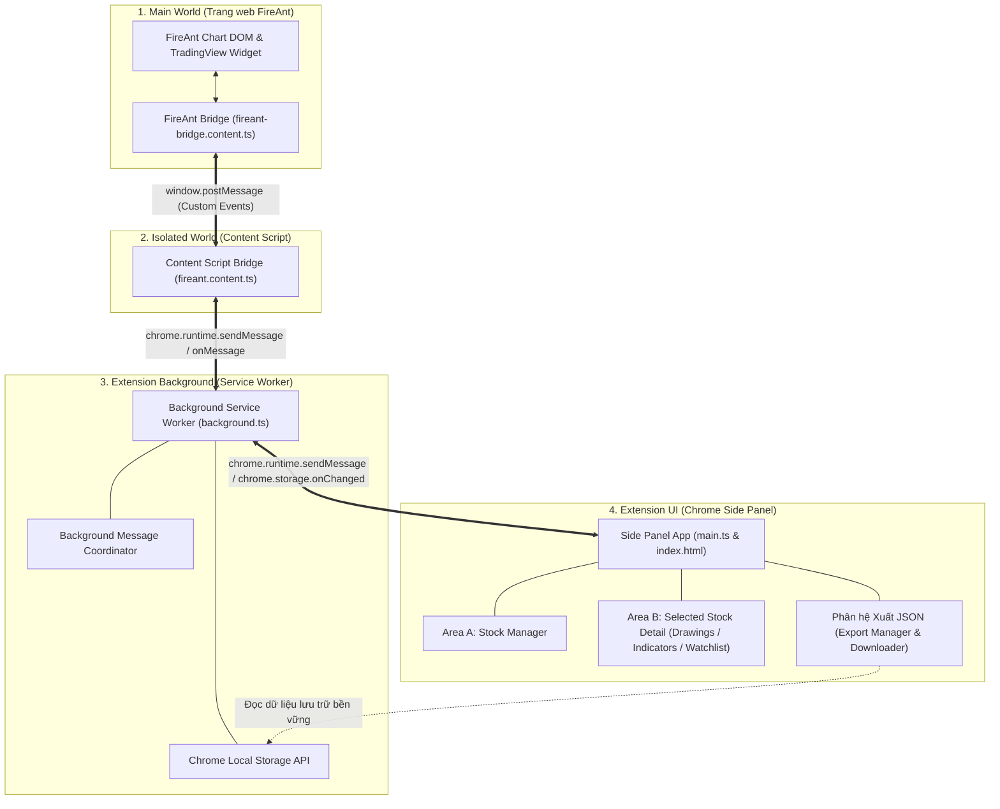
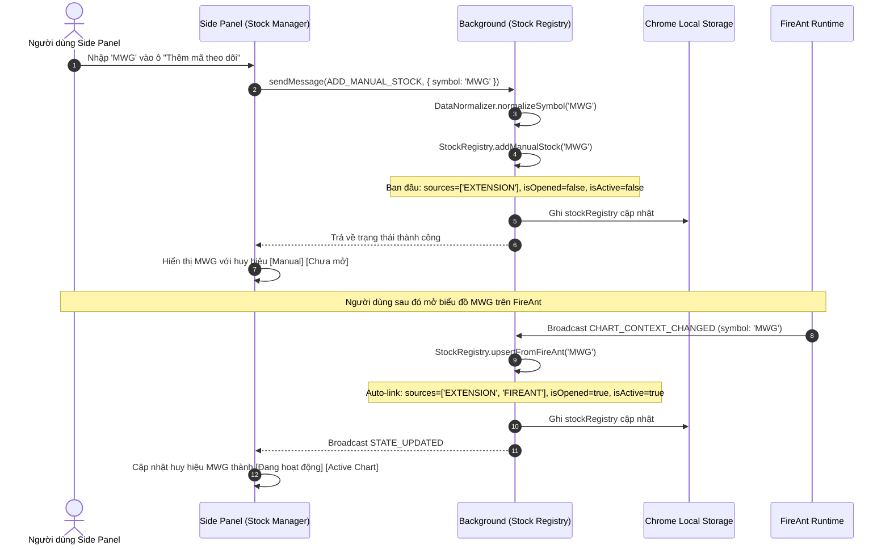
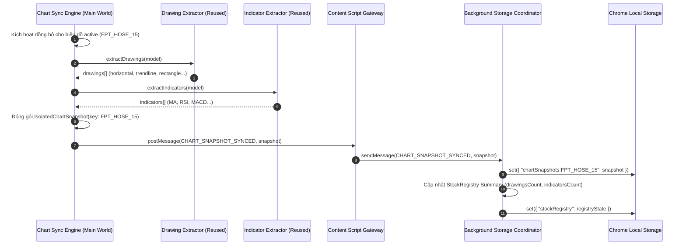
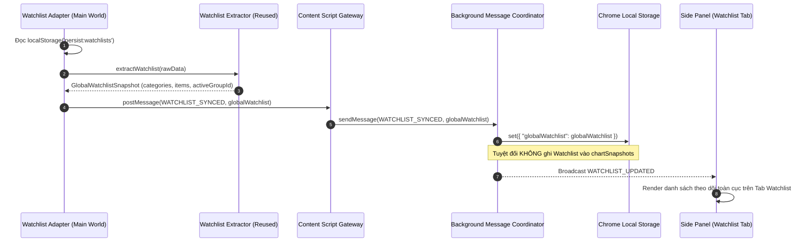
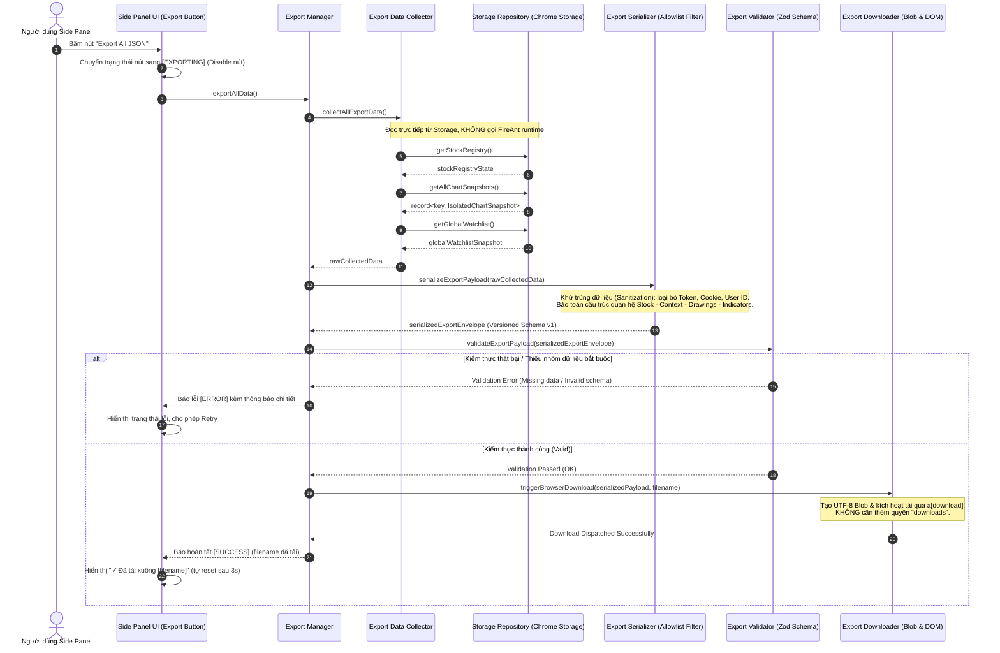

# KIẾN TRÚC HỆ THỐNG QUẢN LÝ ĐA MÃ CỔ PHIẾU (MULTI-STOCK MANAGEMENT ARCHITECTURE)

**Dự án:** Stock Chart Extractor – Multi-Stock Management Architecture  
**Tài liệu:** Thiết kế kiến trúc tổng thể hệ thống, phân rã module, ranh giới xử lý, luồng dữ liệu và Phân hệ Xuất JSON Toàn diện (Export All JSON)  
**Phiên bản:** 2.1  
**Ngày cập nhật:** 17/11/2026  
**Trạng thái kiểm duyệt:** ARCHITECTURE SPECIFICATION (Export All JSON Integrated)

---

## 1. TỔNG QUAN HỆ THỐNG VÀ ĐỊNH HƯỚNG SẢN PHẨM

Hệ thống **Stock Chart Extractor 2.1** được thiết kế lại nhằm giải quyết bài toán cốt lõi: **chuyển đổi từ mô hình trích xuất đơn mã (Single-Stock MVP) sang hệ thống quản lý danh mục đa mã cổ phiếu (Multi-Stock Management)** trên nền tảng web FireAnt (`https://fireant.vn/b/charts`), đồng thời bổ sung tính năng **Xuất toàn bộ dữ liệu ra một tệp JSON duy nhất (Export All JSON)**.

### 1.1. Mục tiêu cốt lõi:
1. **Hợp nhất hai nguồn quản lý mã:**
   - **Nguồn tự động (FIREANT):** Tự động phát hiện các biểu đồ, tab và bố cục đang được mở trên FireAnt, tự động phát hiện biểu đồ đang chọn (Active Chart), mã cổ phiếu (`symbol`), sàn giao dịch (`exchange`) và khung thời gian (`timeframe`).
   - **Nguồn thủ công (EXTENSION):** Cho phép người dùng chủ động thêm mã cần theo dõi hoặc xóa mã khỏi danh sách quản lý của Extension. Tự động liên kết (Auto-linking) mã thủ công khi biểu đồ tương ứng được mở trên FireAnt.
2. **Cô lập và phân vùng dữ liệu nghiêm ngặt:**
   - **Dữ liệu theo biểu đồ (Per-stock, per-timeframe data):** Bao gồm Drawings (đối tượng vẽ) và Indicators (chỉ báo kỹ thuật). Được lập chỉ mục theo khóa phức hợp `symbol + exchange + timeframe + chartId`.
   - **Dữ liệu người dùng toàn cục (Global user data):** Watchlist (danh sách theo dõi cá nhân). Độc lập hoàn toàn với biểu đồ đang chọn; tuyệt đối **không** sao chép Watchlist vào từng Chart Snapshot.
3. **Phân hệ Xuất dữ liệu Toàn diện (Export All JSON):**
   - Đóng gói toàn bộ dữ liệu quản lý (Stock Registry, toàn bộ Chart Snapshots, Drawings, Indicators, Global Watchlist) vào **MỘT tệp JSON duy nhất**.
   - Định danh tệp chuẩn: `stock-chart-extractor_all_YYYY-MM-DD_HH-mm-ss.json`.
   - Thực thi độc lập thông qua `StorageRepository`, không phụ thuộc hay làm gián đoạn runtime của FireAnt.
4. **Bảo toàn và kế thừa mã nguồn MVP:**
   - Bảo toàn 100% các module trích xuất đối tượng vẽ (`Drawing Extractor`, `base.extractor.ts`, các extractor hình học: horizontal line, trendline, rectangle) và các module trích xuất chỉ báo/danh mục đã được nghiệm thu trong MVP và Phase 3.

---

## 2. RANH GIỚI VÀ TIẾN TRÌNH THỰC THI (PROCESS BOUNDARIES)

Hệ thống Chrome Extension Manifest V3 hoạt động trên 4 môi trường ngữ cảnh cô lập (Execution Contexts):



1. **Main World (`fireant-bridge.content.ts`):** Chạy trực tiếp trong ngữ cảnh JavaScript của trang web FireAnt. Có quyền truy cập bộ nhớ RAM của `window.chartWidget`, `chartWidget.model().m_model`, và `localStorage` của FireAnt.
2. **Isolated World (`fireant.content.ts`):** Chạy trong môi trường cô lập của Content Script. Đóng vai trò cầu nối bảo mật (Secure Gateway) chuyển tiếp message giữa Main World và Background Service Worker.
3. **Background Service Worker (`background.ts`):** Điều phối thông điệp (Background Message Coordinator), quản lý lưu trữ bất đồng bộ (`Storage Repository`), đồng bộ trạng thái giữa các tab và Side Panel.
4. **Side Panel (`entrypoints/sidepanel/`):** Giao diện đồ họa người dùng hiển thị trực quan thông tin quản lý mã, dữ liệu biểu đồ được trích xuất và lưu trữ, tích hợp **Phân hệ Xuất JSON Toàn diện**.

---

## 3. PHÂN RÃ VÀ TRÁCH NHIỆM CÁC MODULE KIẾN TRÚC

Hệ thống được tổ chức theo nguyên tắc Single Responsibility Principle (SRP) thành các module chức năng chuyên trách:

| STT | Tên Module | Vị trí ngữ cảnh | Trách nhiệm chính (Single Responsibility) | Trạng thái mã nguồn |
|:---:|---|---|---|:---:|
| 1 | **Chart Tab Detector** | Main World | Phát hiện sự hiện diện của biểu đồ, số lượng biểu đồ trong layout (`chartsCount()`), và các tab làm việc của FireAnt. | Module mới |
| 2 | **Active Chart Tracker** | Main World | Theo dõi biểu đồ đang có tiêu điểm (Active Chart), lắng nghe sự kiện đổi mã (`onSymbolChange`) và đổi khung thời gian (`onIntervalChange`). | Module mới |
| 3 | **FireAnt Chart Adapter** | Main World | Giao tiếp bậc thấp với TradingView Widget của FireAnt; bọc an toàn các lệnh gọi method private để tránh crash khi FireAnt thay đổi API nội bộ. | Module mới |
| 4 | **Drawing Extractor** | Main World / Lib | Duyệt danh sách `allLineTools()` trên model của biểu đồ active, bóc tách tọa độ, giá, thời gian và thuộc tính hiển thị. | **Tái sử dụng 100%** |
| 5 | **Indicator Extractor** | Main World / Lib | Duyệt danh sách `allStudies()` trên model của biểu đồ active, bóc tách tên chỉ báo, tham số input, kiểu đồ thị và màu sắc. | **Tái sử dụng 100%** |
| 6 | **Watchlist Adapter** | Main World | Đọc an toàn dữ liệu danh sách theo dõi của người dùng từ Redux Persist lưu trong `localStorage.getItem('persist:watchlists')`. | Tái sử dụng |
| 7 | **Watchlist Extractor** | Main World / Lib | Giải mã và chuẩn hóa cấu trúc JSON Watchlist thành danh sách nhóm và các mã chứng khoán theo chuẩn hệ thống. | **Tái sử dụng 100%** |
| 8 | **Stock Registry** | Shared / Background | Quản lý danh bạ mã cổ phiếu thống nhất; thực thi quy tắc bảo toàn nguồn sở hữu (FIREANT vs EXTENSION), loại bỏ trùng lặp và kích hoạt auto-linking. | Module mới |
| 9 | **Data Normalizer** | Shared Lib | Chuẩn hóa mã cổ phiếu (uppercase, trim), định dạng thời gian (Unix timestamp ms), làm sạch giá trị số và ánh xạ kiểu đối tượng vẽ/chỉ báo. | Mở rộng |
| 10 | **Chart Sync Engine** | Main World / Background | Điều phối việc trích xuất đồng thời hoặc theo chu kỳ của Drawings và Indicators theo từng ngữ cảnh biểu đồ cô lập. | Module mới |
| 11 | **Watchlist Sync Engine** | Main World / Background | Điều phối việc trích xuất và đồng bộ dữ liệu Watchlist độc lập, ghi vào vùng lưu trữ toàn cục. | Module mới |
| 12 | **Storage Repository** | Background / Side Panel | Đóng gói các thao tác đọc/ghi vào `chrome.storage.local`; phân vùng theo khóa chuyên biệt; xử lý migrate schema. | Module mới |
| 13 | **Background Message Coordinator** | Background | Nhận diện, kiểm thực (Zod validation) và định tuyến các gói tin giữa Content Script và Side Panel; quản lý trạng thái kết nối. | Tái cấu trúc |
| 14 | **Side Panel UI** | Side Panel | Render giao diện hai vùng (Stock Manager & Selected Stock Detail); quản lý tương tác người dùng, chuyển tab. | Tái cấu trúc |
| 15 | **Export Subsystem** | Side Panel / Shared | Gồm 5 module con: Export Manager, Collector, Serializer, Validator, Downloader chịu trách nhiệm đóng gói toàn diện tệp JSON. | **Phân hệ mới** |

---

## 4. CHI TIẾT CÁC LUỒNG DỮ LIỆU ĐIỂN HÌNH (END-TO-END FLOWS)

### 4.1. Luồng Tự động phát hiện và Chuyển đổi Biểu đồ (Automatic Chart Discovery & Active Switch)

```mermaid
sequenceDiagram
    autonumber
    actor User as Người dùng FireAnt
    participant FA as FireAnt Chart Runtime
    participant MWB as Chart Tab Detector / Active Chart Tracker
    participant ICS as Isolated Content Script
    participant BG as Background Message Coordinator & Stock Registry
    participant SP as Side Panel UI

    User->>FA: Mở hoặc đổi biểu đồ sang FPT (Khung 15m)
    FA->>FA: widget.setSymbol('FPT', '15')
    MWB->>FA: Lắng nghe onSymbolChange hoặc Polling Observer
    FA-->>MWB: Model cập nhật: symbol='FPT', timeframe='15'
    MWB->>MWB: Đóng gói ChartContextId (FPT_HOSE_15)
    MWB->>ICS: window.postMessage(CHART_CONTEXT_CHANGED, payload)
    ICS->>BG: chrome.runtime.sendMessage(CHART_CONTEXT_CHANGED)
    BG->>BG: StockRegistry.upsertFromFireAnt(FPT, HOSE, 15)
    BG->>BG: Cập nhật Storage (stockRegistry, activeContext)
    BG->>SP: Broadcast STATE_UPDATED
    SP->>SP: Highlight mã FPT trong Stock Manager; cập nhật Header Detail
```

### 4.2. Luồng Quản lý Mã Thủ công và Tự động Liên kết (Manual Stock Management & Auto-Linking)



### 4.3. Luồng Đồng bộ Dữ liệu Vẽ và Chỉ báo Cô lập (Per-Stock Drawing & Indicator Sync)



### 4.4. Luồng Đồng bộ Danh mục Toàn cục Độc lập (Global Watchlist Sync)



### 4.5. Luồng Xuất Toàn bộ Dữ liệu (Export All JSON End-to-End Flow)



---

## 5. THIẾT KẾ PHÂN HỆ XUẤT DỮ LIỆU TẬP TRUNG (EXPORT ALL JSON SUBSYSTEM)

Phân hệ Xuất JSON Toàn diện chịu trách nhiệm thu thập, làm sạch, đóng gói và tải xuống toàn bộ dữ liệu đã được lưu trữ bền vững. Phân hệ được thiết kế theo mô hình 5 module độc lập:

### 5.1. Export Manager
- **Trách nhiệm:** Là bộ điều phối trung tâm (Coordinator) cho toàn bộ quy trình xuất dữ liệu.
- **Hành vi:**
  - Nhận yêu cầu xuất từ Side Panel UI.
  - Quản lý máy trạng thái xuất (`IDLE` $\rightarrow$ `EXPORTING` $\rightarrow$ `SUCCESS` hoặc `ERROR`).
  - Gọi tuần tự Data Collector $\rightarrow$ Serializer $\rightarrow$ Validator $\rightarrow$ Downloader.
  - Đảm bảo bắt và thông báo mọi ngoại lệ (Exceptions), không nuốt lỗi (fail-safe).

### 5.2. Export Data Collector
- **Trách nhiệm:** Thu thập đầy đủ dữ liệu từ bộ nhớ bền vững `StorageRepository`.
- **Nguyên tắc nghiêm ngặt:**
  - **Chỉ đọc từ Storage:** Tuyệt đối **không** can thiệp hay gọi lệnh trích xuất mới từ runtime FireAnt (tránh làm đơ trình duyệt hoặc sinh race condition khi tab FireAnt đang vẽ).
  - **Không sinh dữ liệu giả lập (No Mock Data):** Dữ liệu xuất phải phản ánh chính xác 100% trạng thái đã lưu trữ thực tế.
  - **Phân biệt rõ trạng thái dữ liệu (Data Completeness):** Phân biệt rạch ròi giữa bản ghi rỗng thành công (`drawings: []`) với trạng thái lỗi trích xuất hoặc chưa được khám phá (`status: "EMPTY"` vs `"FAILED"` vs `"NOT_INVESTIGATED"`).

### 5.3. Export Serializer
- **Trách nhiệm:** Chuẩn hóa dữ liệu thành cấu trúc Envelope JSON phiên bản 1 (`schemaVersion: 1`).
- **Hành vi:**
  - Định dạng thời gian theo chuẩn ISO 8601 kèm múi giờ Việt Nam (`YYYY-MM-DDTHH:mm:ss.sss+07:00`).
  - Bảo toàn mối quan hệ định danh giữa `StockRegistryItem.chartContexts` và mảng `chartSnapshots`.
  - Giữ danh mục `watchlist` ở cấp toàn cục (Top-level), tuyệt đối không nhân bản vào từng biểu đồ.
  - **Cơ chế Khử trùng An toàn (Security Allowlist Sanitization):** Quét lọc qua danh sách trường cho phép; tuyệt đối loại bỏ các trường nhạy cảm như `token`, `jwt`, `cookie`, `password`, `sessionId`, `userEmail`, `userId`.

### 5.4. Export Validator
- **Trách nhiệm:** Kiểm thực gói tin xuất trước khi cho phép tải về.
- **Quy tắc kiểm tra:**
  - Bắt buộc phải có đủ 4 nhóm dữ liệu cốt lõi: `metadata`, `stockRegistry`, `chartSnapshots`, `watchlist`.
  - Kiểm tra `schemaVersion` hợp lệ ($= 1$).
  - Kiểm tra tính toàn vẹn tham chiếu (Referential Integrity): Mọi `chartContext` tham chiếu trong Stock Registry phải tồn tại bản snapshot tương ứng trong `chartSnapshots`.
  - Không cho phép xuất tệp nếu phát hiện dữ liệu bị rò rỉ token hoặc quá trình serialization bị đứt gãy.

### 5.5. Export Downloader
- **Trách nhiệm:** Kích hoạt tải tệp JSON về máy tính người dùng.
- **Cơ chế tương thích Chrome MV3:**
  - Sử dụng cơ chế Web API tiêu chuẩn trong Side Panel:
    ```typescript
    const blob = new Blob([jsonString], { type: 'application/json;charset=utf-8' });
    const url = URL.createObjectURL(blob);
    const a = document.createElement('a');
    a.href = url;
    a.download = generateExportFilename();
    document.body.appendChild(a);
    a.click();
    document.body.removeChild(a);
    URL.revokeObjectURL(url);
    ```
  - **Lợi ích kiến trúc:** Hoàn toàn **không yêu cầu thêm quyền `'downloads'`** trong Manifest, loại bỏ cảnh báo quyền nguy hiểm khi người dùng cài đặt extension.

---

## 6. THIẾT KẾ KIẾN TRÚC GIAO DIỆN SIDE PANEL (TARGET SIDE PANEL ARCHITECTURE)

Giao diện Chrome Side Panel (`entrypoints/sidepanel/`) tổ chức 2 khu vực rõ ràng và bổ sung nút điều khiển Xuất toàn diện:

```
+-------------------------------------------------------------+
| Stock Chart Extractor 2.1                    [STATUS: READY] |
| Platform: FireAnt • Multi-Stock Management                   |
+-------------------------------------------------------------+
| [ KHU VỰC A: STOCK MANAGER (QUẢN LÝ MÃ CỔ PHIẾU) ]           |
|                                                             |
| [+ Thêm mã cổ phiếu: [ VCB       ] [ + Thêm ] ]             |
|                                                             |
| Danh sách mã đang quản lý:                                  |
| • [FPT]   [HOSE • 15m]  ● Active Chart     (5d 2i)      [X] |
| • [VIC]   [HOSE • 1D]   ○ Mở trên FireAnt  (2d 1i)      [X] |
| • [MWG]   [-]           ○ Thủ công (chưa mở)            [X] |
+-------------------------------------------------------------+
| [ KHU VỰC B: SELECTED STOCK DETAIL (CHI TIẾT MÃ ĐANG CHỌN) ]|
|                                                             |
| Đang chọn: FPT • HOSE • Khung: 15m                          |
| [ Tab 1: Drawings (5) ] [ Tab 2: Indicators (2) ] [ Tab 3: Watchlist (18) ] |
|-------------------------------------------------------------|
| (Nội dung Tab được chọn hiển thị tại đây)                    |
| - Tab Drawings: Danh sách hình vẽ & Live JSON               |
| - Tab Indicators: Danh sách chỉ báo kỹ thuật                |
| - Tab Watchlist: Danh mục theo dõi toàn cục                 |
|                                                             |
| [ Copy Tab JSON ] [ Export All JSON ] [ Request Sync ]      |
| [ Trạng thái xuất: Idle / Exporting / Success / Error ]     |
+-------------------------------------------------------------+
```

### 6.1. Chi tiết tương tác nút "Export All JSON":
1. **Trạng thái Mặc định (Idle):** Nút hiển thị màu xanh lá đậm (`#059669`), nhãn `Export All JSON`. Nút ở trạng thái sẵn sàng click. Người dùng không cần chọn thủ công mã nào vì lệnh này xuất toàn bộ kho dữ liệu.
2. **Trạng thái Đang xuất (Exporting):** Nút bị disable, nhãn chuyển thành `⏳ Đang đóng gói dữ liệu...` để tránh click đúp.
3. **Trạng thái Thành công (Success):** Hiển thị nhãn `✓ Đã tải: stock-chart-extractor_all_...json`. Tự động hoàn nguyên về trạng thái Idle sau 3 giây.
4. **Trạng thái Lỗi (Error):** Hiển thị cảnh báo màu đỏ kèm thông tin lỗi (ví dụ: `⚠ Lỗi xuất: Không tìm thấy dữ liệu lưu trữ`), nút chuyển nhãn thành `Thử lại`.

---

## 7. MA TRẬN BẢO TOÀN VÀ TÁI SỬ DỤNG MÃ NGUỒN (REUSABILITY AUDIT)

Hệ thống tuân thủ nghiêm ngặt nguyên tắc **bảo toàn các module trích xuất đã hoạt động ổn định**:

| Tên Module / File | Trạng thái hiện tại | Quyết định kỹ thuật | Lý do & Biện pháp bảo toàn |
|---|---|---|---|
| `src/extractors/base.extractor.ts` | Hoạt động tốt | **Tái sử dụng 100%** | Giữ nguyên interface trích xuất chung của BaseDrawingExtractor. |
| `src/extractors/horizontal-line.extractor.ts` | Hoạt động tốt | **Tái sử dụng 100%** | Giữ nguyên logic trích xuất giá ngang. |
| `src/extractors/trend-line.extractor.ts` | Hoạt động tốt | **Tái sử dụng 100%** | Giữ nguyên logic trích xuất đường xu hướng 2 điểm. |
| `src/extractors/rectangle.extractor.ts` | Hoạt động tốt | **Tái sử dụng 100%** | Giữ nguyên logic trích xuất hình chữ nhật / vùng giá. |
| `src/extractors/fallback.extractor.ts` | Hoạt động tốt | **Tái sử dụng 100%** | Giữ nguyên fallback an toàn cho các line tool chưa hỗ trợ chuyên biệt. |
| `src/extractors/indicators/indicator.extractor.ts` | Hoạt động tốt | **Tái sử dụng 100%** | Giữ nguyên logic bóc tách `allStudies()`. |
| `src/extractors/watchlist/watchlist.extractor.ts` | Hoạt động tốt | **Tái sử dụng 100%** | Giữ nguyên logic decode `localStorage.persist:watchlists`. |
| `src/storage/storage-repository.ts` | Đang hoạt động | **Tái sử dụng & Mở rộng** | Cung cấp nguồn cấp dữ liệu cho `Export Data Collector`. |
| `entrypoints/sidepanel/main.ts` | Đang hoạt động | **Mở rộng** | Gắn trigger sự kiện cho nút `Export All JSON`. |
