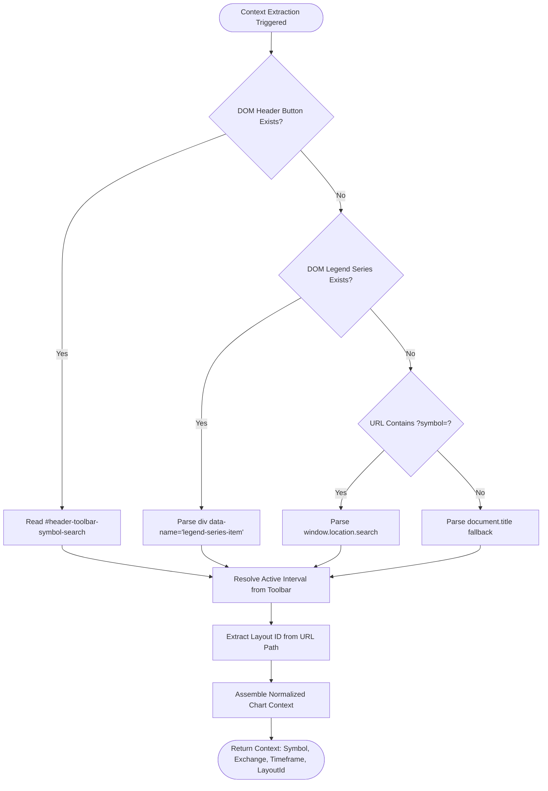

# TRADINGVIEW CHART CONTEXT EXTRACTION RESEARCH

**Document Version:** 1.0.0  
**Research Target:** TradingView Website (`https://www.tradingview.com/chart/`)  
**Project:** Stock Chart Extractor (`d:\Projects\stock-chart-extractor\`)  
**Focus:** Active Chart Context Discovery (Symbol, Exchange, Timeframe, Layout ID, Multi-Chart Layouts).

---

## 1. Executive Summary

A core requirement of Stock Chart Extractor is reliable identification of the active chart's logical context:
$$\text{Logical Key} = (\text{symbol}, \text{exchange}, \text{timeframe})$$
On FireAnt, chart context is discovered via tab elements and the `window.chartWidget` instance. On TradingView Website, our research confirms that **Chart Context extraction is highly feasible and reliable** using a cascading 4-layer extraction architecture.

---

## 2. Multi-Layer Extraction Cascade

### Layer 1: URL Structure Analysis (Primary for Layout ID & Deep Links)
TradingView encodes important layout and routing context directly in the URL:
```
https://www.tradingview.com/chart/[layoutId]/?symbol=[exchange]%3A[symbol]&interval=[timeframe]
```

- **Layout ID:**
  - Standard user layouts: `https://www.tradingview.com/chart/6kM7ZkUv/` $\rightarrow$ `layoutId = "6kM7ZkUv"`.
  - Default anonymous charts: `https://www.tradingview.com/chart/` $\rightarrow$ `layoutId = null`.
- **Query Parameters:**
  - `symbol`: e.g. `NASDAQ%3AAAPL` $\rightarrow$ Exchange: `NASDAQ`, Symbol: `AAPL`.
  - `interval`: e.g. `D` (Daily), `60` (1 Hour), `240` (4 Hours), `W` (Weekly).
- **Reliability:** **MEDIUM-HIGH**. High on initial page load or when navigated via search; however, when users change symbols via the on-screen quick search modal, TradingView often updates internal state without immediately mutating the URL search parameters.

---

### Layer 2: DOM Element Inspection (Primary for Live Symbol & Timeframe)
TradingView's top header toolbar provides stable, accessible DOM anchors that reflect live chart state:

#### 2.1 Symbol Discovery
1. **Header Toolbar Symbol Button:**
   - Selector: `#header-toolbar-symbol-search`, `[data-name="header-toolbar-symbol-search"]`
   - Content: Shows current ticker (e.g. `"AAPL"`, `"BTCUSD"`, or `"VNINDEX"`).
   - Stability: **VERY HIGH**. Present in all desktop layout variations.
2. **Legend Series Item (Top Left of Chart Canvas):**
   - Selector: `div[data-name="legend-series-item"] [class*="title-"]`
   - Content: Shows description and full ticker (e.g. `"Apple Inc · 1D · NASDAQ"`).
   - Stability: **HIGH**.
3. **Document Title (`document.title`):**
   - Pattern: `"AAPL 1D · TradingView"` or `"Apple Inc (NASDAQ:AAPL) Stock Price..."`
   - Stability: **HIGH**. Automatically synchronized by TradingView's title manager.

#### 2.2 Timeframe / Resolution Discovery
1. **Header Intervals Bar:**
   - Container Selector: `[data-name="timeframe-custom-intervals"]` or `div[class*="intervals-"]`
   - Active Interval Button: `button[class*="isActive-"]`, `button[aria-checked="true"]`
   - Value: `"1D"`, `"4h"`, `"15m"`, `"1W"`.
2. **Bottom Time Range Selector:**
   - Selector: `div[data-name="time-ranges"] button[class*="selected-"]`
   - Note: Represents view range (1D, 5D, 1M, 1Y, All), which differs from candle timeframe.

---

### Layer 3: React Fiber State Inspection (Main World Injection)
When executing inside the Main World (`world: 'MAIN'`), scripts can inspect React Fiber nodes attached to header toolbar elements:
- Traversal target: `#header-toolbar-symbol-search`
- Fiber path: `el[__reactFiber$*].memoizedProps`
- Yields:
  - `symbol`: Exact uppercase ticker string.
  - `exchange`: Standardized exchange identifier (e.g. `"NASDAQ"`, `"HOSE"`, `"BINANCE"`).
  - `currency`: Base and quote currencies.
  - `minTick`: Minimum price increment for decimal formatting.

---

### Layer 4: Multi-Chart Layouts (Split Screen Support)
Paid TradingView plans allow split screen layouts (2-chart, 3-chart, 4-chart, 8-chart grid).

#### 4.1 Pane Structure
- Split layouts mount multiple `.chart-container` elements under `.layout__area--center`.
- Each pane has its own independent symbol, timeframe, indicators, and drawings.

#### 4.2 Identifying the Active Chart
- The currently active/focused chart pane receives an active border class:
  ```css
  div[class*="chart-container-border"][class*="active-"]
  div[class*="chart-gui-wrapper"][class*="is-active"]
  ```
- Clicking any pane moves the active focus outline and updates the top header toolbar to reflect that pane's symbol and timeframe.

---

## 3. Recommended Fallback Hierarchy for Stock Chart Extractor

To guarantee 100% accuracy without breaking when TradingView changes minor CSS class names, the extension should adopt this fallback waterfall:



---

## 4. Evaluation Matrix

| Context Attribute | Recommended Selector / Source | Confidence | Failure Mode Fallback |
|---|---|---|---|
| **Symbol** | `[data-name="header-toolbar-symbol-search"]` | **HIGH (99%)** | Fallback to `legend-series-item` $\rightarrow$ `document.title`. |
| **Exchange** | React Fiber prop or Legend series text | **MEDIUM (85%)** | Parse from URL parameter or derive from symbol registry. |
| **Timeframe** | Active button in `[data-name="header-toolbar-intervals"]` | **HIGH (95%)** | Fallback to `document.title` regex match. |
| **Layout ID** | Path segment: `/chart/([a-zA-Z0-9]+)/` | **HIGH (100%)** | `null` for unsaved/anonymous charts. |
| **Active Split Pane** | `div[class*="chart-container"][class*="active"]` | **HIGH (90%)** | Default to index 0 (top-left pane). |
