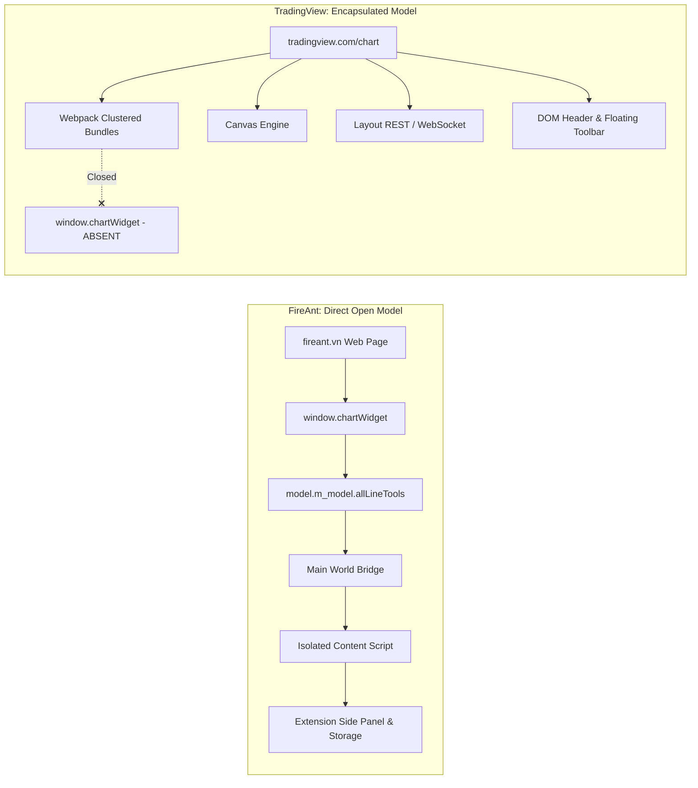
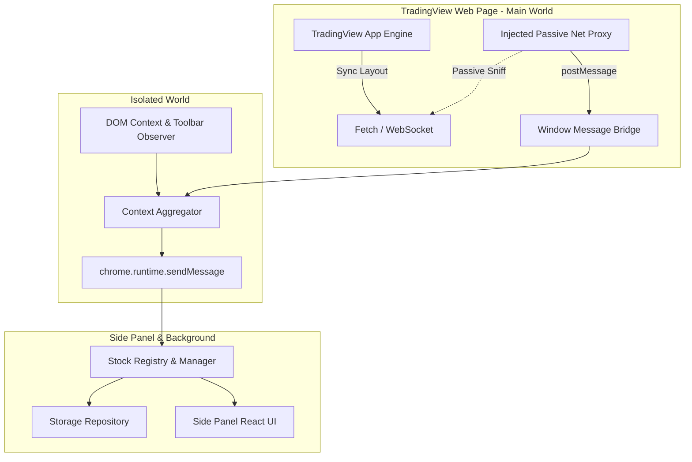

# TRADINGVIEW EXTENSION INTEGRATION ARCHITECTURE

**Document Version:** 1.0.0  
**Research Target:** TradingView Website (`https://www.tradingview.com/chart/`)  
**Project:** Stock Chart Extractor (`d:\Projects\stock-chart-extractor\`)  
**Focus:** Chrome Extension Manifest V3 Integration Pathways, Security Risks, Anti-Bot Considerations, and Roadmap Recommendations.

---

## 1. Architectural Comparison: FireAnt vs TradingView



| Parameter | FireAnt | TradingView Commercial Website |
|---|---|---|
| **Runtime Exposure** | Open `window.chartWidget` global variable. | Completely encapsulated inside Webpack closures. |
| **Drawing Model Access** | Direct synchronous method call `allLineTools()`. | In-memory private engine state synced via network. |
| **Chart Context** | Extracted from DOM tabs + chartWidget info. | Extracted from DOM header buttons, title, and URL. |
| **Integration Complexity** | **Low** (Clean API available out of the box). | **Medium to High** (Requires hybrid proxy/DOM extraction). |

---

## 2. Chrome Extension Manifest V3 Compatibility

### 2.1 Two-World Execution Boundary
In Chrome Extension Manifest V3:
1. **Isolated Content Script (`world: 'ISOLATED'`):**
   - Has access to the DOM tree (`#header-toolbar-symbol-search`, floating toolbar).
   - Has access to Chrome Extension runtime APIs (`chrome.runtime.sendMessage`, `chrome.storage`).
   - **CANNOT** access variables or closures created by TradingView scripts on `window`.
2. **Main World Script (`world: 'MAIN'`):**
   - Injected via `content_scripts` with `world: 'MAIN'` or `chrome.scripting.executeScript({ world: 'MAIN' })`.
   - Runs in the exact same JS execution context as TradingView scripts.
   - Can inspect `window` properties, wrap `fetch` / `WebSocket`, and traverse React Fiber nodes.
   - **CANNOT** call `chrome.runtime.*` APIs directly; must communicate with the Isolated Content Script via `window.postMessage`.

---

## 3. Potential Integration Strategies

### Strategy A: Direct Main World JavaScript Runtime Traversal
- **Method:** Traverse React Fiber nodes on `.chart-container` or probe Webpack runtime closures.
- **Pros:** Completely in-memory, zero network overhead.
- **Cons:** High fragility. TradingView obfuscates internal class names on every weekly release (`class a8x`, `method _$q`). An extension relying on internal minified method names breaks frequently.
- **Feasibility:** **LOW TO MEDIUM**.

---

### Strategy B: Passive Network Interception (Fetch / WebSocket Hook)
- **Method:** Inject a non-destructive wrapper on `window.fetch` and `window.WebSocket` in the Main World.
- **Mechanism:**
  - Intercept responses from `https://layout.tradingview.com/v1/charts/*/`
  - Intercept frames on `wss://data.tradingview.com/socket.io/` containing drawing delta updates.
- **Pros:** Highly resilient to DOM or class name changes; payload schemas for layouts are stable across years.
- **Cons:** Only captures drawings when synced to the server (requires user to be logged in or layout auto-saved).
- **Feasibility:** **HIGH**.

---

### Strategy C: DOM & Storage Inspection
- **Method:** Use `MutationObserver` on the Floating Toolbar (`.floating-toolbar-react-wrapper`) to detect drawing selection/deletion, and parse `localStorage` for cached chart layouts.
- **Pros:** Simple, runs largely in the Isolated World, zero risk of interfering with page scripts.
- **Cons:** Coordinates of unsaved drawings are rendered only on Canvas, making exact numeric coordinate extraction from DOM alone impossible.
- **Feasibility:** **MEDIUM (Context Only)**.

---

### Strategy D: Recommended Hybrid Architecture
The optimal architectural design combines the strengths of Strategies B and C:
1. **Context Discovery (Symbol, Exchange, Timeframe, Layout ID):** Handled via **DOM Header & URL Cascade** (Strategy C) in the Isolated Content Script.
2. **Drawing Lifecycle Triggers:** Handled via **Floating Toolbar Observer** (Strategy C).
3. **Drawing Snapshot Extraction:** Handled via **Main World Passive Network Interception** (Strategy B) capturing clean serialized layout JSON.



---

## 4. Security, Stability, and Anti-Bot Risk Assessment

| Risk Vector | Severity | Mitigation & Best Practice |
|---|---|---|
| **Account Ban / Bot Detection** | **VERY LOW** | The extension is 100% read-only. It does NOT generate synthetic mouse clicks, automated trades, or scrape at high frequency. It merely intercepts responses already dispatched to the browser. |
| **Authentication & Credentials** | **ZERO RISK** | The extension must NOT read, log, or export cookies or authorization headers. All interceptors filter strictly for drawing layout payloads. |
| **Script Invalidation on TV Updates** | **LOW (with Hybrid Strategy)** | By avoiding minified DOM class selectors and relying on stable data attributes (`data-name="header-toolbar-symbol-search"`) and network layout JSON schemas, breaking changes are minimized. |
| **Performance / CPU Overhead** | **NEGLIGIBLE** | Passive event-driven hooks (MutationObserver and Fetch proxy) execute in <1ms without background polling loops. |

---

## 5. Strategic Roadmap & Recommendations for Stock Chart Extractor

1. **Phase 1 (Current):** Research & Prototype Validation (Completed). All prototype probes documented in `research/tradingview/`.
2. **Phase 2 (Architectural Isolation):** Maintain strict separation. FireAnt Drawing Extractor remains the active production implementation.
3. **Phase 3 (Multi-Platform Adapter Pattern):**
   - Introduce a `PlatformAdapter` interface in `src/extractors/`:
     ```typescript
     interface ChartPlatformAdapter {
       platform: 'fireant' | 'tradingview';
       detect(): boolean;
       extractContext(): ChartInfo;
       extractDrawings(): Promise<DrawingObject[]>;
     }
     ```
   - Retain current FireAnt extractor as `FireAntAdapter`.
   - Implement `TradingViewAdapter` utilizing the Hybrid Strategy (DOM Context + Network Layout Sync) when development begins.
